# Sistema de Gestión de Tareas - API REST 🚀

Este proyecto es una plataforma backend estructurada sobre **Flask** y **SQLite**, desarrollada para la Práctica Formativa Obligatoria 2. El sistema provee autenticación segura de usuarios, almacenamiento persistente de credenciales y gestión de tareas personales, integrando un cliente de consola interactivo y renderizado web dinámico.

## 🛠️ Arquitectura y Tecnologías
* **Backend:** Python 3.x con Flask.
* **Base de Datos:** SQLite3 (Motor relacional local, sin dependencias externas).
* **Seguridad:** Werkzeug Security (Cifrado unidireccional de contraseñas mediante hash).
* **Frontend:** Jinja2 (Renderizado dinámico de HTML) y CSS.
* **Cliente:** Script interactivo en consola utilizando la librería `requests`.

## 📌 Endpoints de la API

| Método | Ruta | Descripción | Payload / Parámetros |
| :--- | :--- | :--- | :--- |
| `POST` | `/registro` | Registra un nuevo usuario encriptando su clave. | `{"usuario": "x", "contraseña": "y"}` |
| `POST` | `/login` | Valida credenciales contra el hash de la BD. | `{"usuario": "x", "contraseña": "y"}` |
| `POST` | `/api/tareas` | Guarda una nueva tarea asociada al usuario. | `{"usuario": "x", "descripcion": "y"}` |
| `GET` | `/api/tareas/<usr>`| Retorna la lista de tareas del usuario en JSON. | Parámetro en URL (`<usr>`) |
| `GET` | `/tareas/<usr>` | Renderiza la interfaz web HTML con las tareas. | Parámetro en URL (`<usr>`) |

## 🚀 Instrucciones de Ejecución y Flujo de Pruebas

Para comprobar el correcto funcionamiento del sistema y visualizar los resultados exitosos en la terminal, sigue estos pasos:

1. **Instalar dependencias:**
   Abre una terminal en la raíz del proyecto y ejecuta:
   ```bash
   pip install flask werkzeug requests

2. **Iniciar el Servidor (API):**
   En la misma terminal, enciende el backend:
   ```bash
   python servidor.py

    El motor SQLite generará automáticamente el archivo tareas.db. La API quedará escuchando en http://127.0.0.1:5000.

3. **Ejecutar Pruebas desde el Cliente en Consola:**
   Abre una segunda terminal en el mismo directorio (sin cerrar la del servidor) y ejecuta el cliente interactivo:
   ```bash
   python cliente.py

## 👉 Flujo para verificar las pruebas exitosas

  * Opción 1 (Registro): Ingresa un usuario y contraseña. La consola imprimirá {'mensaje': 'Registro exitoso'}.

  * Opción 2 (Login): Ingresa las credenciales recién creadas. La consola imprimirá {'mensaje': 'Acceso validado a las tareas'}.

  *  Opción 3 (Interfaz Web): Abre automáticamente tu navegador predeterminado para ver el renderizado HTML con Jinja2.

  *  Opción 4 (Agregar Tarea): Crea un par de tareas de prueba para tu usuario.

  *  Opción 5 (Listar Tareas): Verifica que la consola consuma la base de datos y liste tus tareas correctamente.


## 📸 Evidencias de Pruebas Exitosas
A continuación se adjuntan las capturas de pantalla que demuestran el cumplimiento de los requerimientos técnicos de la consigna:

*Nota: Las imágenes se encuentran alojadas en la carpeta /capturas del repositorio.*

1. Persistencia de Datos y Seguridad
   * Evidencia de la creación de la base de datos SQLite y el almacenamiento seguro de contraseñas mediante hashing unidireccional.

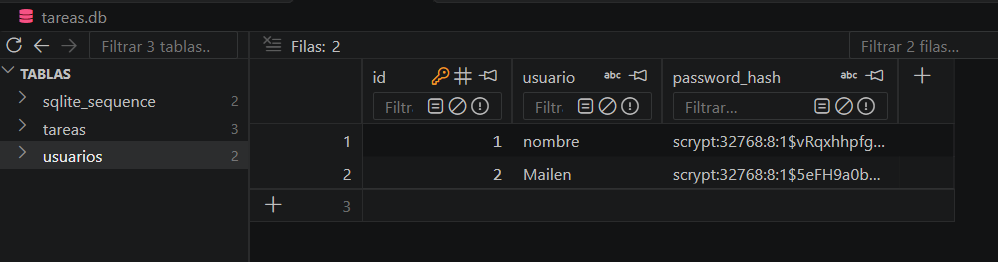
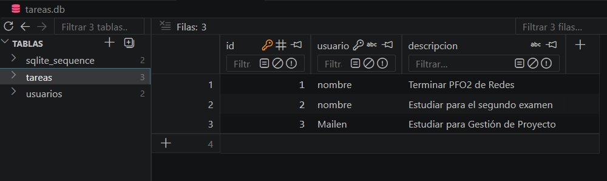


2. Flujo de Cliente en Terminal
   * Evidencia de la comunicación exitosa entre cliente.py y servidor.py.

   **Servidor**
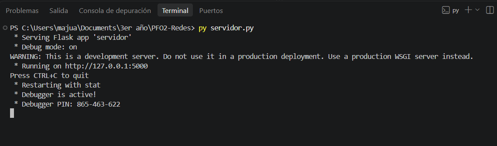

   **Cliente: Registro**
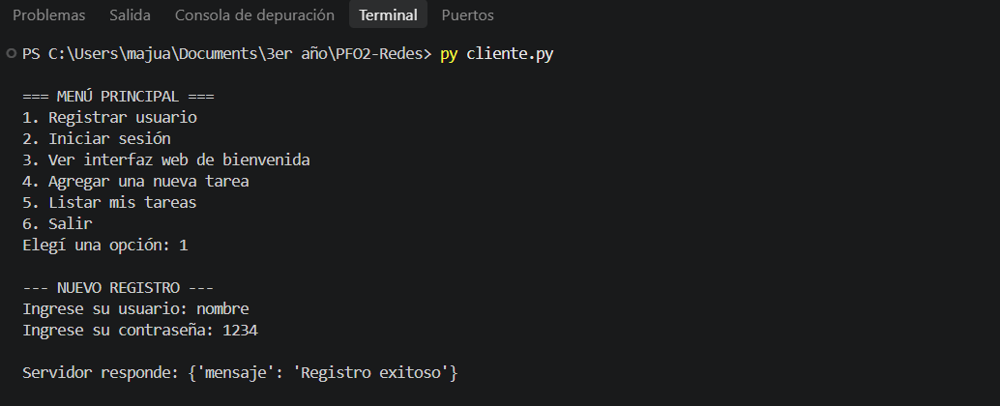  

   **Cliente: Login**
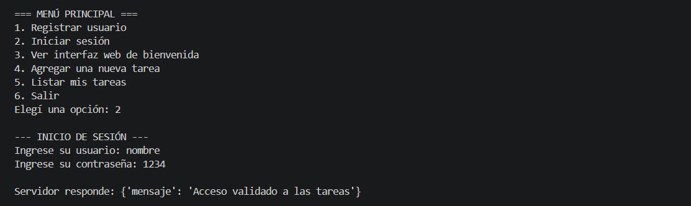

   **Cliente: Interfaz web**  
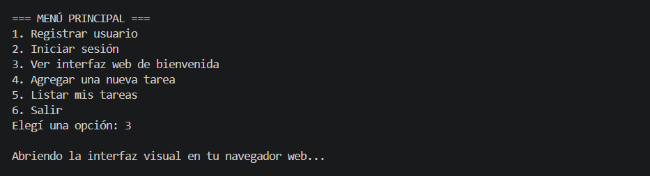

   **Cliente: Agregar tarea**  
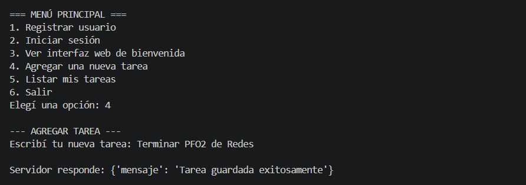

   **Cliente: Listar tareas**  
      Usuario: Nombre  
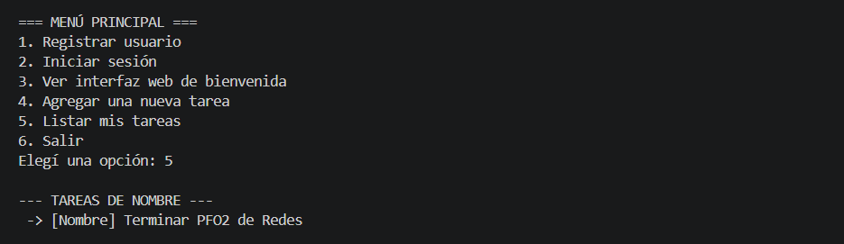

   **Cliente: Listar tareas**  
      Usuario: Mailen  
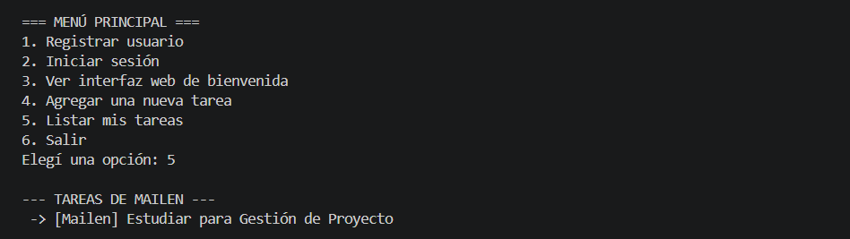

   **Cliente: Salir**  
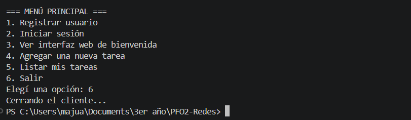


3. Renderizado Web Dinámico
   *  Evidencia del endpoint /tareas/<usuario> funcionando en el navegador web inyectando las variables desde el backend con Jinja2.

Usuario: Nombre   
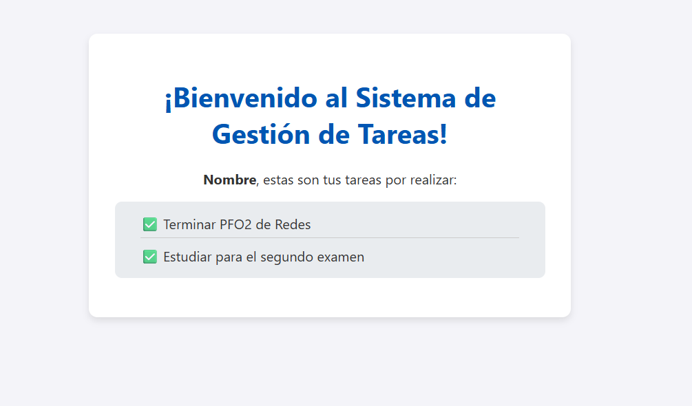

Usuario: Mailen  
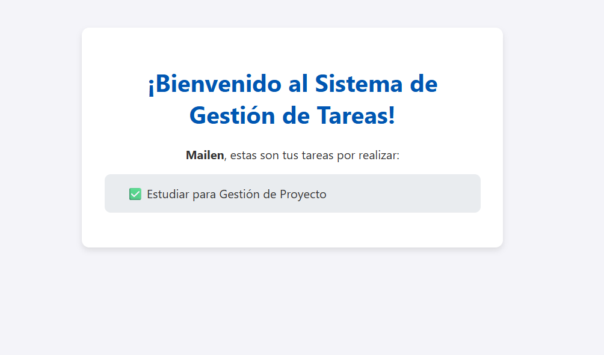


## 🧠 Respuestas Conceptuales  

1. ¿Por qué hashear contraseñas?
El hasheo transforma una contraseña en texto plano en una cadena de caracteres irreconocible mediante un algoritmo criptográfico unidireccional. Esto es un estándar crítico de ciberseguridad: si la base de datos es vulnerada o expuesta, los atacantes no podrán leer las contraseñas reales de los usuarios. A diferencia de la encriptación tradicional, un hash no puede revertirse; el servidor solo valida el acceso aplicando el mismo algoritmo a la contraseña ingresada en el login y comparando si ambos hashs coinciden.

2. Ventajas de usar SQLite en este proyecto.  
   Simplicidad y ligereza: SQLite almacena toda la base de datos en un único archivo local (tareas.db), eliminando la necesidad de instalar, configurar y mantener un motor de base de datos pesado en un servidor externo (como MySQL o PostgreSQL).  

   Integración nativa: No requiere dependencias complejas, ya que la librería sqlite3 viene incluida por defecto en la instalación estándar de Python.  

   Ideal para desarrollo: Permite iterar rápidamente, realizar pruebas locales y reiniciar la base de datos simplemente borrando el archivo .db, lo cual se ajusta perfectamente a la escala y objetivos de este proyecto.

